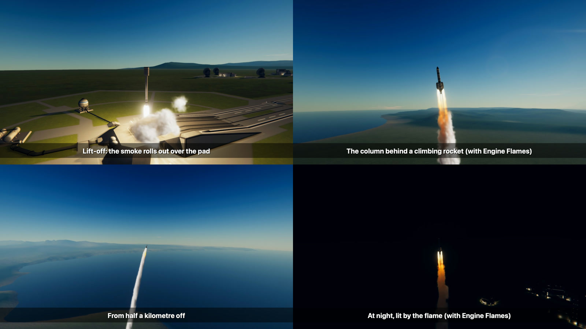
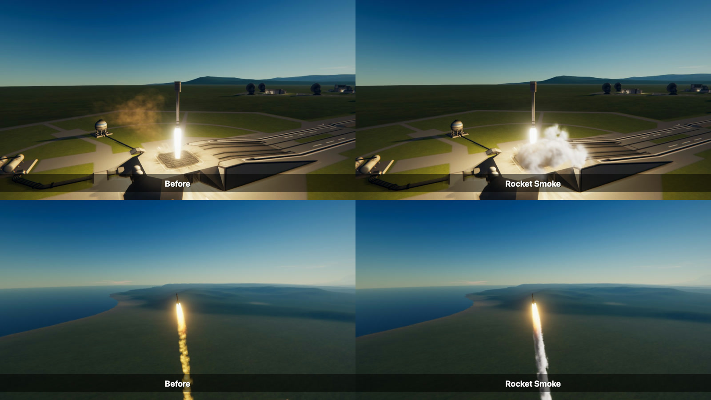

# Rocket Smoke

A rocket's smoke as a true volume: it rolls out over the pad at lift-off, climbs after the rocket in a
column, hangs and drifts in the wind, and is lit by the sun and by the flame.

*The second and fourth pictures are with [Engine Flames](https://github.com/IshiakiZ/ksp-engine-flames) installed as well, which
this smoke is made to go with; the other two have the game's own flames.*

For Kerbal Space Program 1.12.x. Needs [Volumetric Explosions](https://github.com/IshiakiZ/ksp-volumetric-explosions) 0.4.0 or
later, whose smoke this is, and [Keystone](https://github.com/IshiakiZ/ksp-keystone); both come in the download.

**It is made for the game's OpenGL (a Mac, Linux).** Volumetric Explosions draws its smoke with a shader
made for that. On Windows (Direct3D) there is none yet: the mod says so in its settings and leaves the
game's smoke as it is.

## What it does

* **Smoke that is somewhere.** Every engine leaves puffs of smoke where its flame ends. They are carried
  on down the jet, stopped by the air, spread, rise, and are taken by the wind: the same simulated air,
  and the same lit volume, as an explosion's smoke in Volumetric Explosions.
* **It rolls out over the pad.** Where the jet lands the smoke is turned along the ground and rolls up
  from it on every side. Off bare ground it takes the ground's dust with it; off water, spray.
* **A trail that stays.** The column stands behind the rocket for as long as the smoke hangs, a
  kilometre and more of it, leaning with the wind.
* **Lit as it lies.** The sun lights one side of it and its own thickness shades the other; at night it
  is lit by the flame it comes from.
* **What burns shows.** A solid booster's smoke is thick, white and stays; kerosene's is thin and
  grey-brown; hydrogen leaves a little white steam; the small upper-stage engines a thin haze.

*Each pair is one rocket at one moment of its flight, each picture taken in a scene loaded afresh, with the
camera's exposure held still. "Before" is the game's own smoke and its dust on the ground; the flames in
both are the game's and the Waterfall mod's.*

## Install

Copy the `Keystone`, `VolumetricExplosions` and `RocketSmoke` folders from the download's `GameData` into
your KSP `GameData`.

## Settings

In the Keystone window (the keystone button on the game's toolbar, or Option-K on a Mac, Alt-K elsewhere).

| Setting | Installed as | |
| --- | --- | --- |
| Rocket smoke | on | off: the smoke the game draws |
| How much | 1 | |
| How long it hangs | 1 | |
| Hide the game's own smoke | on | off: both are drawn |

## Good to know

* Rocket engines only, and only where there is air to hold smoke: none in a vacuum, less and shorter-lived
  as the air thins. Jets, ion engines and engines that burn something it does not know keep the smoke
  they had.
* While its smoke is drawn for an engine, the game's smoke for that engine is hidden, and so is the flat
  haze of dust the game draws on the ground under it.
* Flames are not its business: [Engine Flames](https://github.com/IshiakiZ/ksp-engine-flames) does for those what this does
  for smoke, and the two are made to be used together.
* Floodlights do not light it. At night it is lit by the flame alone, and the foot of the column is dark.
* It cost next to nothing where it was measured: a Kerbal X (seven engines) left the pad at 39 frames a
  second without it and at 38 with it, and climbed at 45 and at 43; with Engine Flames as well, 39 and 46
  (one flight each way, on an Apple M5 Pro at 1280 by 720, with Scatterer, EVE, TUFX, Waterfall and
  Natural Light). A solid booster's smoke is several times a liquid engine's, and was not measured.
* Made on 2026-10-09 and looked at in pictures and frame by frame: lift-off and climb by day and by
  night, with solid boosters and with liquid engines. Nobody has played with it yet.
* Made and tried on a Mac. Linux uses the same OpenGL shader and should work, but it has **not been run**
  there. On Windows it does nothing yet (see above).

More: [how it works](docs/How-it-works.md).
